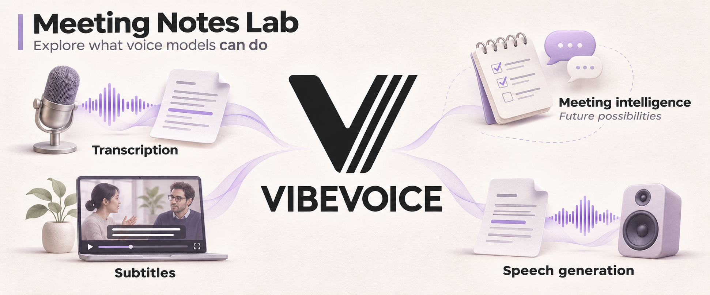
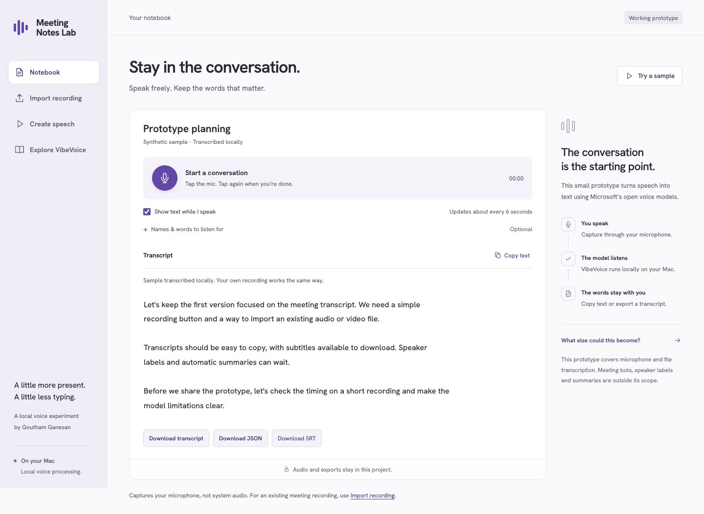
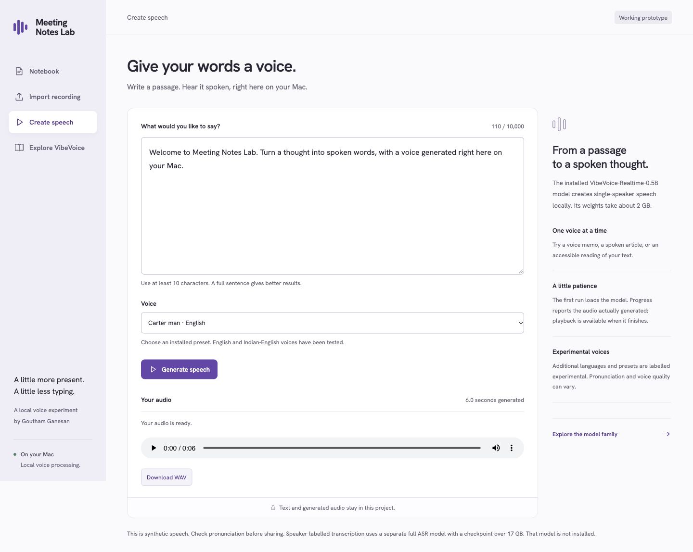
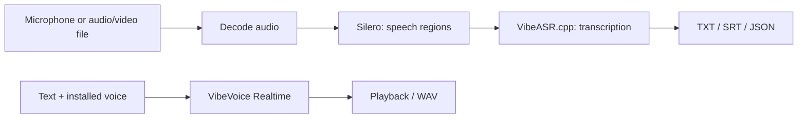

<div align="center">



[](https://www.python.org/)
[](#run-it-locally)
[](https://github.com/microsoft/VibeVoice)

**Record a conversation, turn a video into subtitles, or give your words a voice. On your Mac.**

</div>

# Meeting Notes Lab

A small working prototype exploring what [Microsoft VibeVoice](https://github.com/microsoft/VibeVoice) makes possible on a personal computer. It brings microphone transcription, audio/video import and text-to-speech into a calm meeting-notebook interface.

Built by [Goutham Ganesan](https://www.gouthamg.com) as a product-building experiment. The interesting question was how far compact voice models could take a meeting-notes experience on a 24 GB Mac.

## What you can do

| Start with | Get |
| --- | --- |
| Tap the microphone and speak | Draft text about every six seconds, then a final transcript when you stop |
| Drop in an audio or video file | A transcript, SRT subtitles and JSON segments |
| Type a passage and select a voice | Locally generated speech you can play or download as WAV |
| Open Explore VibeVoice | An explanation of what works here and what needs a larger model or another product layer |

Vocabulary hints help with unfamiliar names and terms. **Try a sample** sends the bundled synthetic recording through the real transcription model.



<details>
<summary>See the speech-generation workspace</summary>



English and Indian-English voices were tested locally. Other installed presets are labelled experimental. You can stop a generation and download any audio already produced.

</details>

## Which models does this need?

The speech-generation model and the large speaker-labelled transcription models are **different models**.

| Capability | Runtime | Model download | Included in default setup? |
| --- | --- | --- | --- |
| Transcription | VibeVoice-ASR-BitNet via VibeASR.cpp | About 1.70 GB | Yes |
| Speech-region detection | Silero VAD | About 2.3 MB | Yes |
| Text-to-speech | VibeVoice-Realtime-0.5B | About 2.04 GB, plus tokenizer/presets | Optional |
| Speaker-labelled transcription | Full VibeVoice ASR models | About 17 GB per model when checked | No |

These are file sizes, not memory requirements. Dependencies and build tools need additional disk space. The default setup never downloads the large ASR models.

## Run it locally

Tested on **Apple M5, 24 GB unified memory, Python 3.11**. Other platforms have not been verified.

Install [uv](https://docs.astral.sh/uv/), Git and the Xcode command-line tools. From the project folder:

```sh
python3 scripts/setup.py
./start.command
```

Open [localhost:7860](http://127.0.0.1:7860/). Setup creates a virtual environment, installs dependencies, builds the pinned C++ runtime and downloads checksum-verified compact models.

For a terminal-only launch:

```sh
.venv/bin/python -m uvicorn server:app --host 127.0.0.1 --port 7860
```

**This installs transcription.** To enable Create speech, follow the [optional speech setup](docs/speech-experiment.md). Speech generation needs its separate model and Python dependencies. It uses Apple Metal on the tested Mac.

To verify an existing compact installation without downloads:

```sh
python3 scripts/setup.py --check
```

## How it works



The browser handles recording and the workspace. A local FastAPI server coordinates decoding, transcription and speech generation. Inference runs locally; setup downloads dependencies and model files.

## What this prototype leaves open

- **Meeting intelligence:** summaries, decisions, action items and source-linked answers need another reasoning layer. The banner labels these as future possibilities.
- **Meeting capture:** microphone input only. There is no system-audio capture, meeting bot or calendar integration.
- **Speaker identity:** the compact runtime does not provide verified speaker labels here.
- **Subtitle precision:** captions follow detected speech phrases. Review the words and timing before sharing; there is no word-level forced alignment.
- **Storage:** there is no persistent meeting library or account system. Files remain on disk, while the workspace and job list are temporary.

Live transcription is a draft; the final pass replaces it after recording stops. Recordings stop automatically after 30 minutes, and imported files have a 4 GB upload limit.

Speech playback begins after generation finishes. The API also exposes intermediate audio chunks; the browser does not play those chunks live.

<details>
<summary>A lesson from building it</summary>

A synthetic clip transcribed correctly as a whole, but splitting it into very short phrases led to invented words. Grouping nearby short phrases restored enough context to fix that test.

That shaped the subtitle pipeline: speech detection supplies approximate phrase boundaries, while short adjacent regions are merged before decoding. The product's input choices affect what the model gets right.

</details>

## Local data

Uploads, converted recordings, transcripts and generated speech remain under `outputs/`. They are **not automatically deleted**. Closing the browser does not stop the server; stop its terminal with Control-C.

The launcher binds to localhost, and the API rejects unrelated browser origins. This is a single-user local prototype, without authentication or a deployment configuration for public hosting.

Models, vendor checkouts, recordings, logs, environments and unpublished personal drafts are excluded from Git. The bundled demo audio and test fixtures are synthetic; see [sample provenance](docs/sample-provenance.json) and [fixture provenance](tests/fixtures/README.md).

## Development and verification

```sh
uv pip install --python .venv/bin/python -r requirements-dev.txt
node --check static/app.js
python3 scripts/setup.py --check
```

With the app running and Google Chrome installed on macOS:

```sh
.venv/bin/python scripts/browser_test.py
.venv/bin/python scripts/speech_ui_test.py
```

The first harness uses synthetic microphone/media fixtures. The speech UI harness mocks generation jobs and reads the installed voice catalog; it needs the optional voice presets.

For real speech generation and a speech-to-transcript round trip, after installing the optional runtime:

```sh
.venv/bin/python scripts/speech_test.py
```

The local build was exercised with mic start/stop, streaming on/off, video import, export formats, silence, video audio offsets, desktop/mobile layouts and keyboard navigation. Real speech checks covered English and Indian-English generation, playback, WAV download and cancellation with partial audio. These are local checks, not a CI badge or a claim of cross-platform coverage. A fresh-machine end-to-end installation has not yet been verified.

| File | Purpose |
| --- | --- |
| [server.py](server.py) | Local API, decoding, transcription and subtitle orchestration |
| [tts_engine.py](tts_engine.py) | Optional speech-generation runtime |
| [static/](static/) | Notebook, import, speech and education views |
| [scripts/setup.py](scripts/setup.py) | Compact runtime installation and checksum verification |
| [model-manifest.json](model-manifest.json) | Compact model revisions and hashes |
| [SETUP.json](SETUP.json) | Tested hardware, source revisions and build commands |
| [DESIGN.md](DESIGN.md) | Interface design system |

`requirements.txt` is the minimal transcription environment. `requirements.lock.txt` records the full tested environment, including optional speech dependencies; it is not a minimal installer.

## Credits and license

Built with [Microsoft VibeVoice](https://github.com/microsoft/VibeVoice), [VibeASR.cpp](https://github.com/microsoft/VibeASR.cpp), [Silero VAD](https://github.com/snakers4/silero-vad), [FastAPI](https://github.com/fastapi/fastapi) and [PyAV](https://github.com/PyAV-Org/PyAV).

[Hanken Grotesk](https://github.com/google/fonts/tree/main/ofl/hankengrotesk) is bundled under the [SIL Open Font License](static/fonts/OFL.txt). The generated banner uses the official VibeVoice logo as its reference; [image provenance](docs/banner-provenance.json) records the source and prompt. Logos and marks belong to their respective owners.

This is an independent experiment, with no affiliation with Microsoft or Wispr. **No license for this project's original code has been selected yet.** Upstream code, models, fonts and marks retain their own terms.
